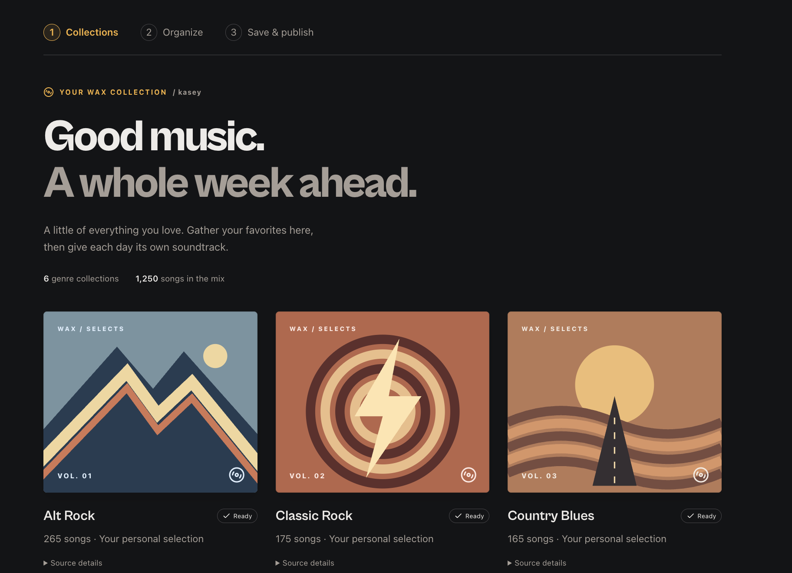
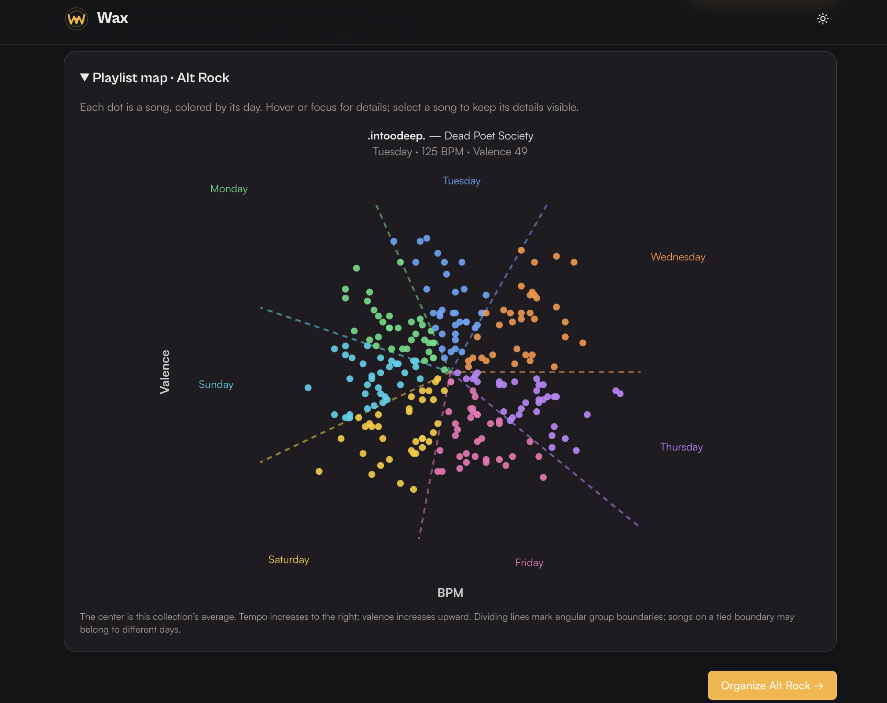
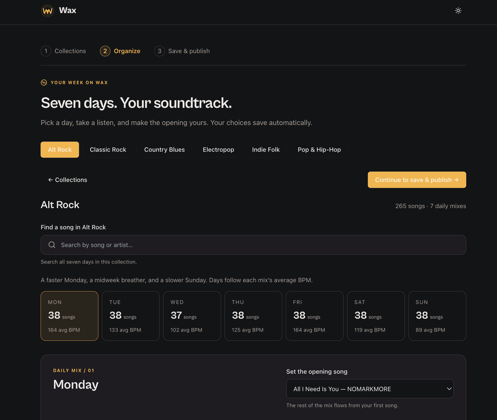
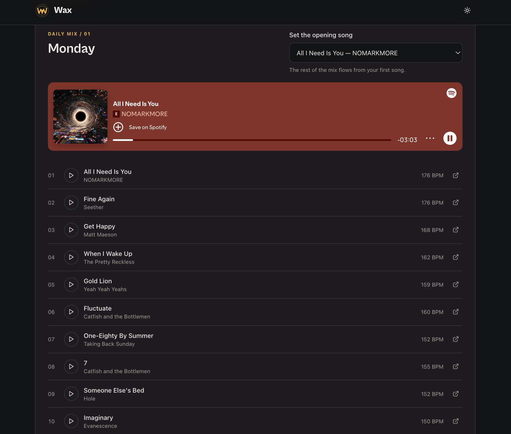
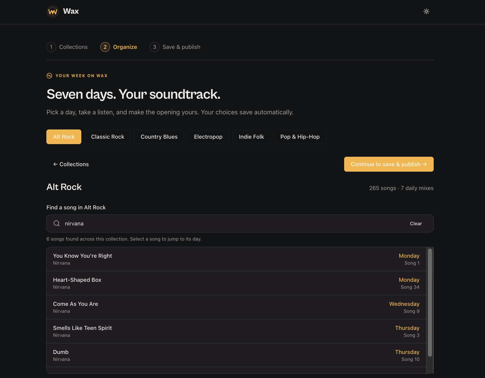
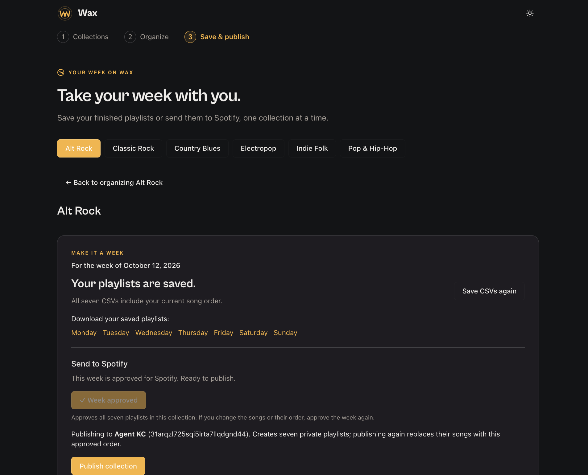
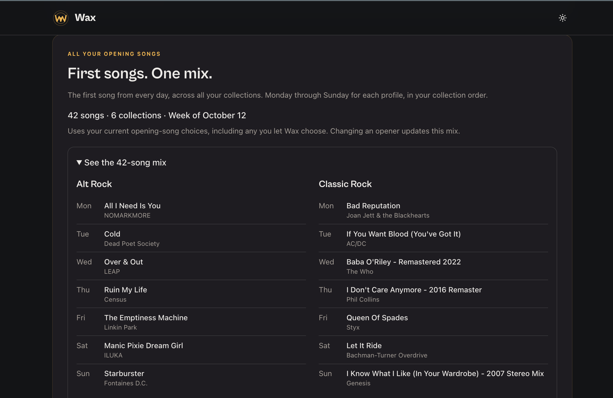
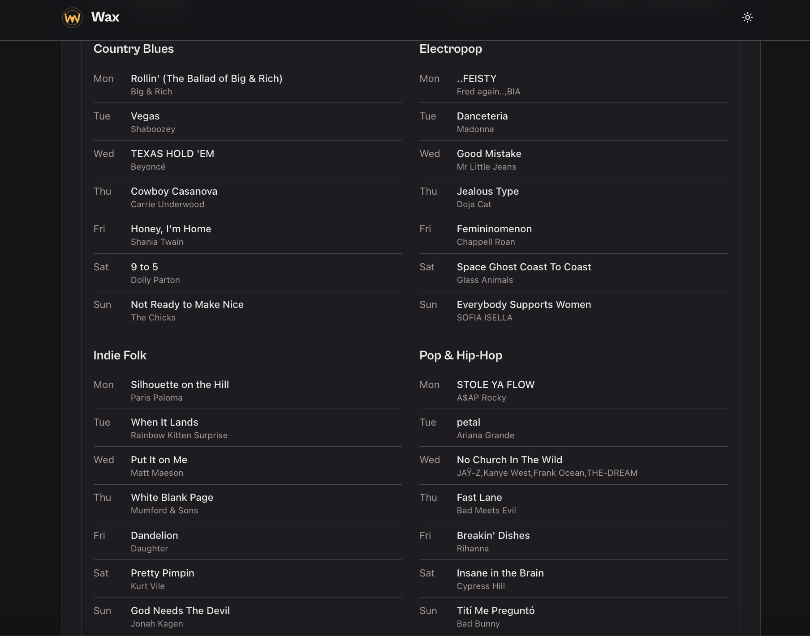
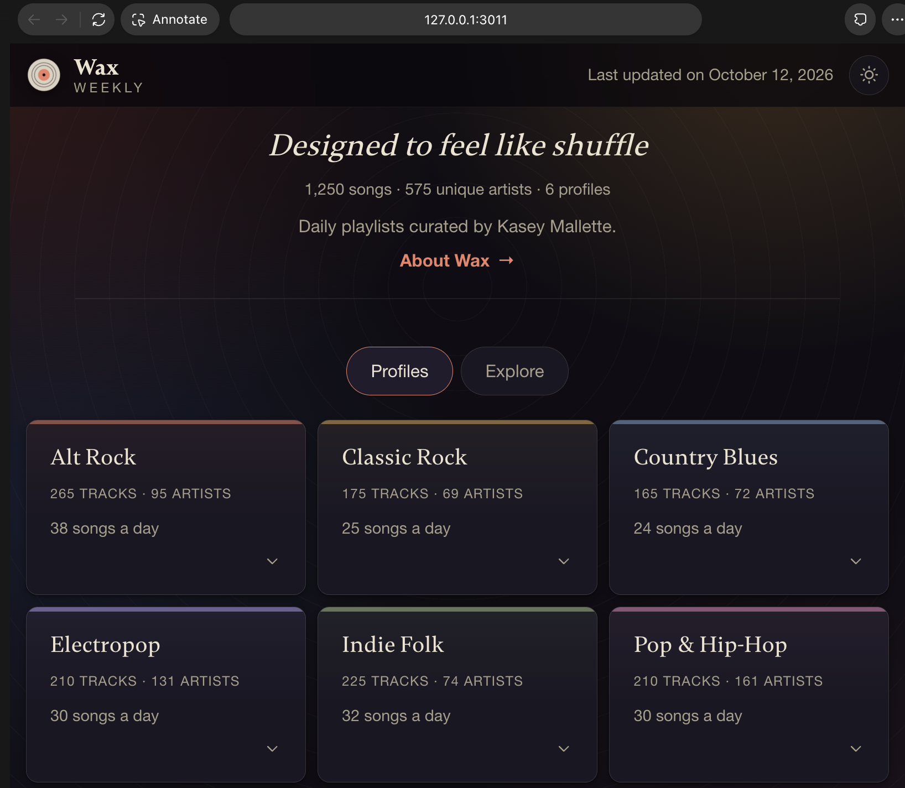

# Wax

Wax is a local-first playlist app that turns personally curated genre collections into a deliberate weekly rotation. It uses **equal-count angular clustering on BPM and valence**, **nearest-neighbor sequencing**, and the **Spotify Web API** to build and publish seven daily playlists per collection.

[Wax Weekly](https://waxweekly.com/) turns the Wax workflow into a weekly listening experience across six genre-bending profiles: **Alt Rock, Classic Rock, Country Blues, Indie Folk, Pop & Hip-Hop, and Electropop**. Every song is curated by me, then distributed and sequenced using Wax.

## Introduction

Wax started with a simple frustration: **I wanted to listen to playlists on shuffle and hear every song.**

There is a real problem with random playback, and it's not just me who thinks they've heard the same song for the fourth time. In 2025, Spotify introduced **Fewer Repeats** after listeners reported that Shuffle felt repetitive, with certain songs and artists surfacing again and again. Spotify’s engineers attributed that experience to statistical randomness itself: a random sequence does not guarantee an even distribution, even when every track has an equal chance of appearing. [Spotify Engineering, “Shuffle: Making Random Feel More Human”](https://engineering.atspotify.com/2025/11/shuffle-making-random-feel-more-human). 

Given that I often shuffled my entire Liked Songs library, which contained thousands of songs, making it through a complete random sequence was nearly impossible. I would search for a song, switch playlists, change genres, or navigate somewhere else, replacing the queue before the sequence ever finished. The next time I hit Shuffle, songs I had already heard had another chance of landing near the front of the queue.

So I started making smaller playlists. Even then, I noticed that not every song appeared in the playback queue when I hit Shuffle. **Fewer Repeats** generates several random versions of a playlist, then uses listening history to choose which sequence to play. I wanted something simpler: **a guarantee that every song I selected would make it into the rotation.** With access to more music than anyone can realistically listen to, discovery is only half the problem. The real challenge is keeping great songs from disappearing back into an endless library.

Instead of generating another random order, I wanted to know that the songs in my active listening library were being **deliberately distributed across the week.** I wanted repetition, because I like hearing songs again. I wanted novelty, because I did not want to hear the same subset constantly. And I wanted the individual playlists to have enough musical continuity that they still felt good to listen to from beginning to end.

**So I built my own system.**

## The app

Wax brings my genre collections together in one local app: **Collections → Visualize → Organize → Save & publish**.

### 01: Collections

Your music starts here. Browse your genre collections and choose one to turn into a week of listening:



### 02: Visualize

See how each collection becomes seven daily playlists. Wax plots songs by standardized **BPM and valence**, then divides them into consecutive angular groups with nearly equal song counts. Each group includes songs near the collection’s center and farther out, giving it a shared direction with room for variation.

Monday starts in green in the upper-left group, and Tuesday through Sunday follow clockwise. Hover over or select a song to see its title, artist, day, BPM, and valence above the chart.



See [all six collection maps and the angular partition details](features/angular-partition/README.md#playlist-maps).

#### How angular clustering developed

Wax originally used balanced K-means on BPM and a combined Mood score. As I listened and made my own playlist orders, I wanted to explore groups that could share a musical direction while still allowing bigger differences between songs. That led to a question: what would happen if I divided the collection around its center, like slices, instead of seeking compact clusters?

I built an offline experiment using standardized BPM and valence, comparing equal-angle slices, equal-count angular groups, concentric rings, and balanced K-means on the same two features. I inspected song counts, distance from the center, and within-group spread. Those measurements described the groups; they could not tell me which playlists would sound best.

For the app, I chose equal-count angular groups so every song would have a place and each day would have a similar number of songs. I kept nearest-neighbor sequencing unchanged to explore the new membership through listening. The interactive maps made the results visible across all six collections, and I chose Monday in the upper left with the week moving clockwise. This is a listening-driven iteration, with the [original experiment and results](features/angular-partition/README.md) preserved for comparison.

### 03: Organize

Once angular clustering determines which songs belong to each day, **nearest-neighbor sequencing determines their order**. Wax uses standardized BPM and **Mood = Energy + Danceability + Valence** to measure how close songs are. It starts with the song nearest the group's center, then repeatedly picks the closest remaining song until every track is included.

Choose your own opening song to give the playlist a different starting point; Wax recalculates the rest of the sequence from that song while keeping the day's membership unchanged. Opening-song choices save automatically.

Explore a collection's seven daily playlists, with song counts and average BPM for each day:



The opening-song selector and track previews sit inside each day's playlist:



Looking for a song or artist? Search the collection to see which day each song is on:



### 04: Save & publish

Take your week with you. Save a collection's seven daily playlists as CSVs, approve the week, and send them to Spotify:



Once all seven playlists are on Spotify, Wax saves a weekly snapshot and gives you links to each day's playlist:



#### First-song playlist

First songs. One mix. Bring together the opening song from every day across all profiles.


The mix includes six genre profiles: Alt Rock, Classic Rock, Country Blues, Electropop, Indie Folk, and Pop & Hip-Hop. Save it as a CSV or publish it as its own Spotify playlist:



## Wax Weekly

[Wax Weekly](https://waxweekly.com) is the public listening site in `wax_weekly/`. It presents genre collections and daily playlists with song details and Spotify links.



After publishing all six collections to Spotify in Wax, prepare the website release from the repository root:

```bash
npm run weekly:release
```

This reads the published v2 snapshots in `users/kasey/snapshots/` and updates `wax_weekly/data.js` and `wax_weekly/art.js`. Song order and Spotify playlist links come directly from the snapshots, including Electropop. Existing album artwork is reused when available.

The **Explore** tab contains the **First Songs jukebox**, features each daily opener in profile order. Visitors can use Previous/Next, arrow keys, or swipe the song card, listen through the Spotify player, and choose **Explore [genre] · [day]** to jump to that full daily playlist. **Profiles** opens by default and keeps the genre cards and daily playlists together. Explore links switch to Profiles and select the matching genre and day. Spotify controls playback and preview availability. When a published First Songs snapshot matches the website's opening songs in the same order, the release also includes a link and expandable player for the full mix. Publish the mix in Wax and rerun `npm run weekly:release` to include it.

The command selects the newest snapshot week and requires all six collections to have a complete published snapshot for that same week. If a collection is missing, it stops without changing the website files. If a collection was published more than once that week, its most recently published snapshot wins.

To select a particular week or validate without writing files:

```bash
npm run weekly:release -- --week 2026-10-12
npm run weekly:release -- --check
```

The website's user and profile order are configured separately in `wax_weekly/release.json`. This command does not use `WAX_USER`, so running the local app for a parent does not change the website's source. Other Wax users do not need a website or release configuration. The older `npm run weekly:site:build` command is an alias for the same v2 builder.

Review the generated files, then commit and deploy `wax_weekly/` through your normal hosting workflow. The release command does not publish to Spotify, commit, push, or deploy. Snapshots stay local; run the command on the computer holding the published snapshots before deploying the generated site files.

## Methods

### 1. Create a user folder

Each user has a folder containing one config file and a `profiles` folder for their source playlist CSVs. Using my username, `kasey`:

```bash
mkdir -p users/kasey/profiles
```

My six genre collections are organized like this:

```text
users/
└── kasey/
    ├── config.json
    └── profiles/
        ├── alt-rock.csv
        ├── classic-rock.csv
        ├── country-blues.csv
        ├── electropop.csv
        ├── indie-folk.csv
        └── pop-hip-hop.csv
```

I maintain the music in each collection outside Wax. Each CSV is the complete source for one genre; every song in a valid source gets a place in the week's playlists.

### 2. Create the user config

Create `users/kasey/config.json` with the username, profile names, and paths to the CSVs:

```json
{
  "username": "kasey",
  "profiles": [
    {
      "id": "kasey-alt-rock",
      "name": "Alt Rock",
      "masterCsvPath": "profiles/alt-rock.csv",
      "stationId": "kasey-alt-rock",
      "enabled": true
    },
    {
      "id": "kasey-classic-rock",
      "name": "Classic Rock",
      "masterCsvPath": "profiles/classic-rock.csv",
      "stationId": "kasey-classic-rock",
      "enabled": true
    },
    {
      "id": "kasey-country-blues",
      "name": "Country Blues",
      "masterCsvPath": "profiles/country-blues.csv",
      "stationId": "kasey-country-blues",
      "enabled": true
    },
    {
      "id": "kasey-electropop",
      "name": "Electropop",
      "masterCsvPath": "profiles/electropop.csv",
      "stationId": "kasey-electropop",
      "enabled": true
    },
    {
      "id": "kasey-indie-folk",
      "name": "Indie Folk",
      "masterCsvPath": "profiles/indie-folk.csv",
      "stationId": "kasey-indie-folk",
      "enabled": true
    },
    {
      "id": "kasey-pop-hip-hop",
      "name": "Pop & Hip-Hop",
      "masterCsvPath": "profiles/pop-hip-hop.csv",
      "stationId": "kasey-pop-hip-hop",
      "enabled": true
    }
  ]
}
```

- `username` matches the user folder and the `WAX_USER` used to launch the app.
- `id` is a unique, stable profile identifier. It is also used in Spotify playlist names.
- `name` is the display name shown in the app.
- `masterCsvPath` is relative to the config file, so `profiles/alt-rock.csv` resolves inside `users/kasey/`. Absolute paths also work.
- `stationId` is optional metadata for the weekly site; the current publisher uses `id`.
- `enabled` controls whether the profile participates in the workflow.

A user can have one profile or several. Keep usernames and IDs lowercase, using hyphens between words.

### 3. Prepare the source CSVs

Place one master CSV per profile in `users/kasey/profiles/`. The current parser expects these column names:

| Column | Requirement |
| --- | --- |
| `Song` | Song title |
| `Artist` | Artist name |
| `Spotify Track Id` | Unique 22-character Spotify track ID |
| `BPM` | Positive number |
| `Energy` | Number from 0–100 |
| `Dance` | Danceability, from 0–100 |
| `Valence` | Number from 0–100 |

Optional columns include `Album`, `Album Date`, and `Camelot`.

Each enabled profile must contain **70–700 songs**. Wax checks every enabled CSV before opening the workflow. If a file is missing, has invalid data, or falls outside that range, the Collections page explains what needs fixing. Update the source file, then click **Refresh collection**.

### 4. Run Wax

From a fresh checkout, install dependencies first:

```bash
git clone https://github.com/kaseymallette/wax.git
cd wax
npm install
```

After creating your user folder, config, and source CSVs, start the app from the repository root:

```bash
WAX_USER=kasey npm run dev
```

Open [Wax locally](http://127.0.0.1:3000).

To switch users, stop the server with **Ctrl+C** and start it with the other username:

```bash
WAX_USER=kaseysdad npm run dev
WAX_USER=kaseysmom npm run dev
```

Switch genres within the app; there is no need to restart between profiles. Always specify `WAX_USER` to select the intended user. Run only one app instance per user while editing or publishing.

### 5. Organize the week

On **Collections**, check that the source playlists are ready, then choose **Visualize playlists**. Explore the collection’s map and choose **Continue to organize** to inspect a genre and day.

Wax groups songs using two dimensions:

- **BPM**, the song’s tempo.
- **Valence**, the audio feature describing musical positivity, from 0–100.

Each dimension is centered on the collection’s mean and divided by its population standard deviation. Wax computes each song’s angle around that center, sorts counterclockwise from the positive BPM direction, and splits that order into seven consecutive groups. Exact angle ties are broken by Spotify track ID. Every source song appears once, and playlist sizes differ by at most one song. For example, 193 songs become four playlists of 28 and three playlists of 27.

**Monday is the group containing the upper-left direction (135°)**. The remaining days follow clockwise around the map. A group’s angular width depends on how densely songs occupy that direction, so balanced song counts do not require equal-sized slices. Average BPM is still displayed on each day card, but it does not determine weekday assignment.

Within each daily playlist, sequencing uses **BPM and Mood**, where **Mood = Energy + Danceability + Valence**. Wax standardizes those two dimensions across the collection, starts with the song nearest the group’s center in that space, then repeatedly chooses the nearest remaining song. Choose a different opening song from the dropdown to immediately recalculate the sequence. **Opening-song choices save automatically.**

Use the preview button to open a Spotify embed or the Spotify link to listen there. Search by song title or artist across the selected genre's entire week; each result shows its day and position. Select a result to jump to that song.

Generation is deterministic for an unchanged source. Editing a source CSV resets its saved opening choices and approvals when the app next loads it.

### 6. Save and publish

Choose **Continue to save & publish** when the collection is ready. The page displays the target week: **next week, beginning next Monday**, based on the computer running Wax. For example, preparing playlists on October 11, 2026 targets October 12–18.

**Save playlist CSVs** writes all seven playlists in their current order and offers individual downloads. Spotify access and approval are not required to save CSVs. The app shows **Your playlists are saved** when the current version has been exported for that week.

To publish the selected collection:

1. Click **Approve this week** to approve all seven playlists together.
2. Click **Check Spotify account** and verify the destination account.
3. Click **Publish collection**.

Publishing saves the CSVs, creates or updates seven private Spotify playlists, and then saves a weekly snapshot. For my Alt Rock profile, the names are:

```text
Wax - Kasey-alt-rock Monday
Wax - Kasey-alt-rock Tuesday
Wax - Kasey-alt-rock Wednesday
Wax - Kasey-alt-rock Thursday
Wax - Kasey-alt-rock Friday
Wax - Kasey-alt-rock Saturday
Wax - Kasey-alt-rock Sunday
```

Repeat for each genre. Publishing again updates the existing Wax playlists for that profile and day. Changing songs or their order requires approving the week again.

If publishing fails partway through, use **Retry publish**. Progress is saved after each successful Spotify playlist update. If only the weekly snapshot failed, retrying saves the snapshot without repeating completed Spotify writes.

#### First-song mix

On **Save & publish**, **First songs. One mix.** brings together the opening song from every day across all enabled profiles. It follows the profile order in your config, with Monday–Sunday together for each profile. Kasey's six profiles make a 42-song mix: Alt Rock first, then Classic Rock, Country Blues, Electropop, Indie Folk, and Pop & Hip-Hop.

Expand the mix to check the songs, then choose **Save mix CSV** or check your Spotify account and choose **Publish first-song mix**. The Spotify playlist is named `Wax - Kasey First Songs`. Updated choices replace the songs in the same Spotify mix. CSV exports keep each version separately. The mix uses your current opening-song choices, including any you let Wax choose; after changing an opener, return to Save & publish or select **Refresh mix**. Your daily playlists keep their existing order.

## Spotify setup

CSV generation works without Spotify credentials. Publishing uses the Spotify account authorized in the local `.env` file; changing `WAX_USER` does not change that Spotify account.

Create `.env` from `.env.example` if you do not already have one. Fill in the credentials for your Spotify developer app:

```dotenv
SPOTIFY_CLIENT_ID=your_client_id
SPOTIFY_CLIENT_SECRET=your_client_secret
SPOTIFY_REDIRECT_URI=http://127.0.0.1:8888/callback
SPOTIFY_REFRESH_TOKEN=
WAX_USER=kasey
```

Configure the same redirect URI in your Spotify app settings, then run:

```bash
npm run spotify:auth
```

Authorize the account you want to publish to. Copy the refresh-token line printed by the helper into `.env`, then restart Wax. The helper requests playlist read and modification permissions. Keep `.env` local; it is excluded from Git.

## Saved files

Wax creates these folders as you use the app:

```text
users/kasey/
├── config.json
├── profiles/     # Master CSVs you maintain
├── state/        # Opening choices, approvals, and publish progress
├── exports/      # Seven CSVs and a manifest per exported version
└── snapshots/    # Weekly JSON snapshots after successful publishing
```

Export folders use the genre, target Monday, and a short version fingerprint—for example, `alt-rock-2026-10-12-<fingerprint>`. CSV names are shorter, such as `alt-rock-monday.csv`. Saving a changed version creates another export folder; previous versions are retained.

Configs, source CSVs, and exports can be tracked in Git. Local state, snapshots, credentials, and backups are ignored. Back up `state/` and `snapshots/` separately if you want to preserve opening choices, publish progress, and weekly history outside this computer.

To commit finished exports, review the changes and stage the intended files:

```bash
git add users/kasey/config.json users/kasey/profiles users/kasey/exports
git commit -m "Save Kasey's weekly playlists"
git push
```

## Troubleshooting

- **A collection needs a fix:** expand its source details on Collections, correct the CSV, and click **Refresh collection**.
- **The wrong user appears:** stop the server and restart with `WAX_USER=kasey npm run dev`; check that the config username matches.
- **Port 3000 is in use:** stop the previous server, or use `PORT=3001 WAX_USER=kasey npm run dev` and open port 3001.
- **CSV files show as unsaved after an edit:** save them again to export the new order. Opening choices still save automatically.
- **Spotify authorization fails:** check `.env`, run `npm run spotify:auth` again if needed, and restart the app.

## Development

Planned features include [custom playlist days](features/custom-playlist-days/README.md)
and a [daily rotation](features/daily-rotation/README.md). Each feature folder can
start with a proposal and hold implementation notes or experiment data later.

The [playlist flow sequencing proposal](features/playlist-flow-sequencing/README.md)
uses three custom playlist orders to explore positional Camelot moves, musical
arcs, artist spacing, and a future shared ranking model. Its development CSVs
are stored with the proposal; production sequencing is unchanged.

The [angular partition feature](features/angular-partition/README.md) documents the app’s
current equal-count BPM–valence grouping, clockwise weekday assignment, and all six
collection maps. It also retains the earlier comparison with concentric bands and
balanced K-means, including reproducible charts and per-song assignments.

```bash
npm run check
npm run build
WAX_USER=kasey npm start
```

The local app uses React, TypeScript, Vite, Express, Tailwind, shadcn/ui, and TanStack Query. Wax Weekly uses HTML, CSS, and JavaScript.

## License

MIT
