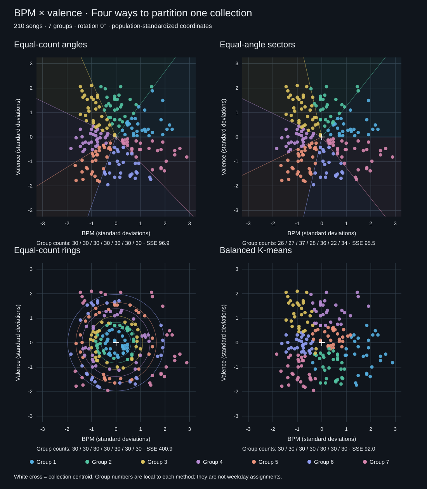
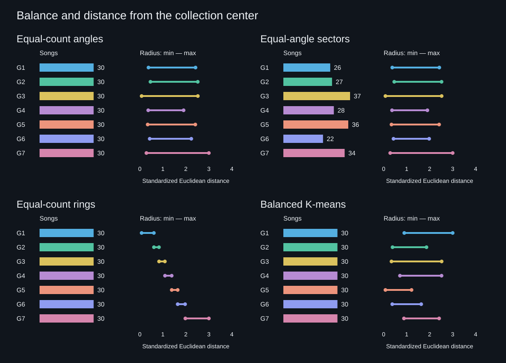

# Measured results

Source: `users/kasey/profiles/pop-hip-hop.csv` (210 validated songs). SHA-256: `d6e2b4c1be08b524447c4ea8e4ac9707ecdf8ac2c0fb23be555c4295d2adadda`.

Centroid: **121.60 BPM, 48.76 valence**. Population standard deviations: 28.54 BPM and 22.96 valence. Rotation: 0°.

| Method | Group counts | Within-group SSE |
| --- | --- | ---: |
| Equal-count angles | 30, 30, 30, 30, 30, 30, 30 | 96.94 |
| Equal-angle sectors | 26, 27, 37, 28, 36, 22, 34 | 95.49 |
| Equal-count rings | 30, 30, 30, 30, 30, 30, 30 | 400.93 |
| Balanced K-means | 30, 30, 30, 30, 30, 30, 30 | 92.00 |

Every method assigns all 210 source IDs exactly once. Equal-count angular boundaries split 0 exact angle ties. There are 0 exact-centroid songs and 2 songs within radius 0.25 (a descriptive threshold, not an exclusion).

## Equal-count sector profiles

| Sector | Songs | Mean BPM | Mean valence | Min radius | Max radius |
| --- | ---: | ---: | ---: | ---: | ---: |
| 1 | 30 | 152.5 | 60.2 | 0.38 | 2.42 |
| 2 | 30 | 122.9 | 77.5 | 0.46 | 2.52 |
| 3 | 30 | 96.9 | 72.7 | 0.08 | 2.52 |
| 4 | 30 | 93.9 | 46.8 | 0.36 | 1.90 |
| 5 | 30 | 97.9 | 26.5 | 0.34 | 2.41 |
| 6 | 30 | 130.1 | 21.2 | 0.43 | 2.24 |
| 7 | 30 | 157.0 | 36.4 | 0.29 | 3.00 |

## Interpretation

Equal-count angular groups guarantee balance while retaining direction; their angular widths adapt to the sample density. Equal-angle sectors provide fixed geometry but do not guarantee balance. Radial bands group central and extreme songs separately. SSE describes compactness in the same standardized feature space for every method; it does not measure listening quality. K-means here uses BPM and valence, not production's BPM and composite Mood.

The reference screenshots describe 210 songs but one displayed count totals 209. These outputs are computed from the local CSV and checked by ID coverage rather than copied from those screenshots.

No constant-feature warnings.

